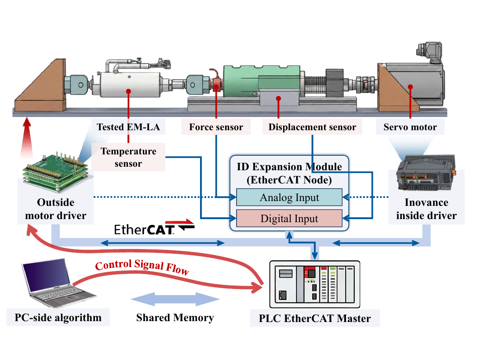

# S-III. Baselines, Design Parameters, and Test Protocol

## Baselines

Table S4 gives the baseline settings. All constrained methods impose the ±60 A peak limit and the same slew limit and termination tolerance, and use $N_p=12$, $N_c=6$ except $B_3$; the 16.5 A continuous rating of the motor is enforced by the $I^2t$ protection of the drive for every method. Hyperparameters of the baselines and of CA-KMPC were selected by nested validation on conditions excluded from the tests.

### Table S4. Baseline Configurations

| Method | Model / law | Key settings | Data |
|---|---|---|:-:|
| $B_1$ adaptive PID | PID + σ-modification | $K_{p0}=2000(1+k_a)$, $K_i=100$, $K_d=50$, $\gamma=4000$ | S |
| $B_2$ tube MPC | Koopman lift + tube | $Q=\mathrm{diag}(4\times10^6,4\times10^3)$, $R=0.05$, 36 A reserved | S |
| $B_3$ online KMPC | 12-D lift + projected RLS | $N_p=15$, $N_c=8$, $R=2.0$, $\lambda=0.98$ | S |
| $B_4$ bilinear KMPC | bilinear EDMD, 11-D; successive linearization | $R=2.0$ | P |
| $B_5$ deep KMPC | 25 Gaussian RBF features | $R=2.0$ | S |
| $B_6$ Koopman-LQR | pretrained 12-D $(A_K,B_K)$; Riccati | $Q_e=\mathrm{diag}(2000,500)$, $R=2.0$ (shared) | P |
| $B_7$ ADRC | linear ESO + PD | $\omega_o=240$, $\omega_c=20$ rad/s, nominal $b_0$ | P |
| $B_8$ NMPC | Table S2 model; SQP-RTI | same $Q_e$, $R$ | P |
| $B_9$ offset-free | 2nd order + input disturbance; QP | observer bandwidth 120 rad/s | P |
| Fixed PD | feedforward + PD | gains from a validation grid of nine pairs $(K_{p0},K_d)$ | P |
| CA-KMPC | 17-D lift; certified QP + triggering | Table S9 | P |

S: separate session on the same bench (cross-session check below); P: paired session.

### Table S9. Design Parameters and Implementation Settings of CA-KMPC

| Group | Parameter | Value |
|---|---|---|
| Predictive layer | horizons $N_p$, $N_c$ | 12, 6 |
| | weights $Q_e$, $R$ | $\mathrm{diag}(2000,500)$, 2.0 |
| | lifted dimension, regressor dimension, coefficients | 17, 90, 1530 |
| | identification snapshots | $2.8\times10^5$ |
| | cap on the vertex spectral radius after scaling | 0.98 |
| Deployed solver | method | dual projected Gauss–Seidel (PGS) on the condensed QP |
| | iteration cap, termination tolerance | 5000, 1 mA |
| | completion deadline $T^{\mathrm{dl}}_{\mathrm{qp}}$ | 650 µs |
| | design bound $T_{\mathrm{oh}}$ (measured maximum) | 300 µs (235 µs) |
| Online update (15)–(16) | $N_u$, $\lambda_f$, $\epsilon_{\mathrm{exc}}$ | 185, 0.9998, $10^{-3}$ |
| | update-budget parameter $\beta$ of $\bar b_G$ | 0.008 |
| | test (A4) | comparison with stored slacks, no online linear program |
| | time per sample (RLS); per update (tests (A1)–(A4)) | 6.7–9.1 µs; 3–6 ms |
| Supervisor | $\alpha$, $N_d$, hysteresis | 0.05, 20, 0.9 / 1.1 |
| | score buffer | 2000 samples |
| | start-up | $M_1$ for 500 ms with 200 consecutive samples in $\Omega_{\mathrm{in}}$; 30 ms score window |
| Learned policy | ensemble | 5 networks 15-64-32-16-1, 3649 parameters each |
| | training data | $9.8\times10^4$ samples; −3 to 3 kN; 25–45 °C; both directions |
| Score | inputs of $d_M$; covariance | $[z;\bar F_{\mathrm{ext}};\bar T]$; Ledoit–Wolf shrinkage |
| | $\sigma_{\mathrm{ens}}$ | sample standard deviation of the five outputs |
| | decimation; strata of the second calibration half | 20 samples; 12 217 / 12 217 / 12 216 / 12 216 |
| | $n$, $q_\nu$ | 48 866, 1.4222 |
| Real time | processor; operating system; compiler | Intel i7-14650HX, performance cores at 2.2 GHz; Ubuntu 22.04 with PREEMPT_RT; gcc 11 -O3 -march=native |
| | soft PLC (EtherCAT master) | isolated performance core, priority 95 |
| | control thread | isolated performance core, SCHED_FIFO 90, locked and preallocated memory |
| | background update and tests | third isolated core, SCHED_FIFO 25 |
| | isolation; model replacement | isolcpus, nohz_full, rcu_nocbs; double buffer with an atomic pointer swap at a cycle boundary |

Source: `cakmpc_supp/parameters.py`, `tables/tableS9_design_parameters.csv`.

## Bench and real-time configuration

Fig. S3 details the electrical and signal topology of the dual-servo bench of Fig. 4. The joint under test is driven by an external motor driver, and the opposing servo motor, driven by an Inovance drive, forms the 2 kW loading axis. The load cell in the load path, the laser displacement sensor on the carriage, and the PT100 thermometers on the actuator housing are sampled through the analog and digital inputs of an EtherCAT input/output module. A soft PLC on an isolated core of the control computer acts as the EtherCAT master of both drives and the module, and the control algorithm exchanges measurements and current commands with it through shared memory. Every measurement and every command of a control cycle therefore passes through one 1 kHz EtherCAT cycle, and the bench latencies of Table II, measured from sampling to the completion of the EtherCAT transfer, cover this entire path. The background update of Section III-E runs on its own isolated core at lower priority and hands an accepted model to the control thread at a cycle boundary, so that it does not enter the 1 ms loop.

**Fig. S3.** Electrical and signal topology of the dual-servo bench in Fig. 4. Red: control signal flow from the control algorithm through the EtherCAT master, a soft PLC on an isolated core of the same computer, to the driver of the joint under test. Blue: signals of the force, displacement, and temperature sensors to the inputs of the EtherCAT input/output module. Light blue: EtherCAT bus linking the two drives, the module, and the master.

## Test protocol

**Reference.** The reference of Section VI-A is derived from joint-level gait data of a humanoid platform driven by linear joints: the dominant frequency components and the amplitudes of the knee and ankle actuator strokes were rescaled to the stroke and velocity range of the joint under test. The gait data are provided in `data/humanoid_gait/`.

**Soft emergency stop.** A trial diverges when $\lvert e_1\rvert>0.3\,x_{\mathrm{range}}$ or $\lvert e_2\rvert>0.5\,v_{\mathrm{range}}$ (0.05 relative margin), $x_{\mathrm{range}}$, $v_{\mathrm{range}}$ being the peak-to-peak excursions of the reference; these thresholds define $\mathcal E_{\mathrm{op}}$.

**Added noise (mismatch tests).** Variances $5\times10^{-14}$ m², $3\times10^{-7}$ m²/s², 25 N², 0.01 A², and 0.01 °C² (position, velocity, force, current, temperature).

**Tuning of $B_7$ and of the fixed PD law.** Validation grades $\{2,10,18\}\,\%$ with five realizations each, disjoint from the tests; a grid $(\omega_o,\omega_c)\in\{60,120,240,400\}\times\{20,40,80\}$ rad/s, then $b_0\times\{0.7,1.4\}$ for the two best pairs; objective: median RMSE, configurations with a divergence inadmissible. $(240,20)$ reached 24.3 µm, against 24.5 µm for $(120,40)$. The fixed PD law was tuned on a grid of nine gain pairs $(K_{p0},K_d)$ around $(2000,50)$ over the same validation grades.

**Cross-session check.** $B_1$, $B_2$, $B_3$, and $B_5$ were measured in a separate session on the same bench. In the paired session, the means of CA-KMPC, $B_4$, and $B_6$ at 0 %, 8 %, and 20 % mismatch reproduced the values of the separate session within 21 %, 16 %, and 5 %, below the acceptance threshold of 30 % fixed before the comparison. Ranking statements of the article use the paired session only.

**Plant-side perturbations.** On the $R_c$ load reference, the loading axis adds $F_{\mathrm{em}}=\Delta M\ddot x+\Delta B\dot x+\Delta F_c\,\mathrm{sign}(\dot x)$, with the acceleration obtained from the low-pass filtered second difference of the position, at the levels of Table V: inertia +10 % and +20 % of $M$, viscous damping +20 % and +40 % of $B_v+\sigma_2$, and direction-dependent friction +20 % and +40 % of $F_c(0)$. $F_{\mathrm{em}}$ is removed from the force signal supplied to the feedforward and to all controllers, so that it acts as an unmodeled change of the plant. A pilot with the fixed PD law verified that each emulated force tracks its target within 20 %. The six methods alternate within each level, with the realization order randomized.

**Supervisor and start-up.** Buffer of 2000 samples; hysteresis ±0.1 about $\nu=1$; dwell $N_d=20$. Phase 1 holds $M_1$ for 500 ms (about $26\tau_{\mathrm{sys}}$) and requires 200 consecutive samples in $\Omega_{\mathrm{in}}$; Phase 2 fills a window of $\max(1.5\tau_{\mathrm{sys}},30\ \mathrm{ms})=30$ ms; Phase 3 checks that the score stayed below the threshold over it. No re-entry into the start-up phase is implemented.

**Admission test.** Every bench experiment executes the complete admission test (20).

**Thermal protocol.** 2.5 kN preload applied at 25 °C; heating to 60 °C in 120 s; feedforward and $B_8$ model temperatures frozen at 25 °C; trials start after at least 65 min of natural cooling.

**Organization of the trials.** $R_1$ and $R_c$ trials last 25 s, $R_2$ and $R_3$ trials 120 s. $R_2$ trials, whose RMS current exceeds the 16.5 A continuous rating, run at most three in a row, followed by a 10 min cool-down without load. The housing temperature enters the scheduling vector and is therefore measured and logged in every cycle of every trial. Within a session, the methods alternate within each regime or level.
