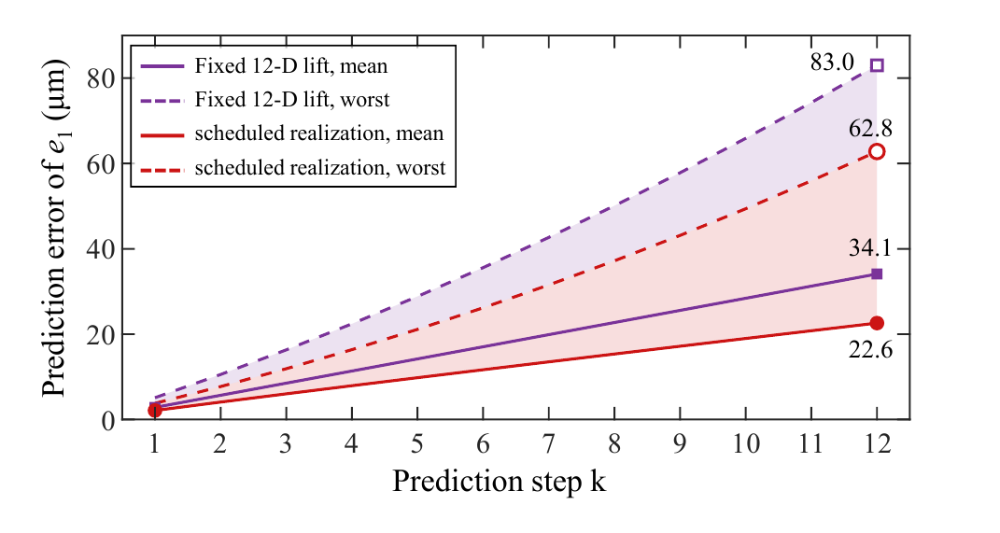
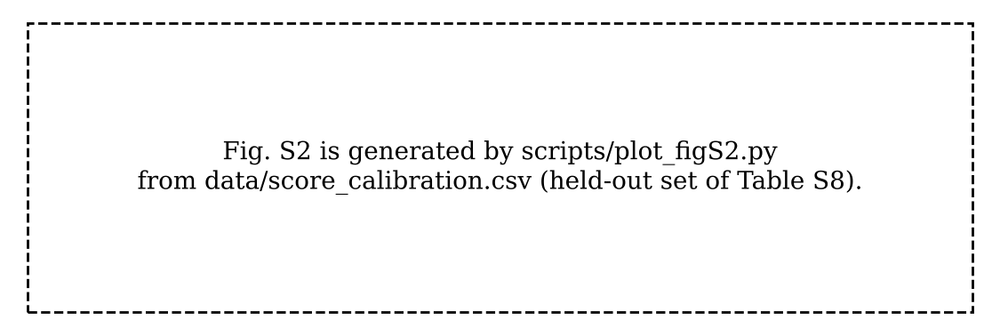

# S-II. Lifted State, Scheduling, and Calibration

## Lifted state

Table S3 lists the lifted coordinates of (4). Each coordinate $\xi_i$ is normalized by $s_i=\kappa_i\max_{k\in\mathcal T_{\mathrm{tr}}}\lvert\xi_i(x_k)\rvert$, $\kappa_i\in[1.5,3]$, over the training set $\mathcal T_{\mathrm{tr}}$; $\bar F_N$ uses $F_{N0}=1000$ N, and $s_a$, $s_{\mathrm{vel}}$ are the $R_c$ reference peaks (448 mm/s², 135 mm/s). The previewed coordinates $s_v$ and $\bar a$ are taken from the reference preview at every prediction step rather than propagated by $A_{cc}$, so that the change $\bar\delta_c$ of the predicted context (Section S-IV) vanishes in these coordinates.

### Table S3. Composition of the Physics-Guided Lifted State

| # | Coordinate | Role |
|---|---|---|
| 1–2 | $e_1,\ e_2$ | physical tracking output |
| 3–4 | $\tanh(e_1),\ \tanh(e_2)$ | unit-scale saturation |
| 5–6 | $\tanh(e_1/2),\ \tanh(e_2/2)$ | mid-regime nonlinearity |
| 7 | $\tanh(e_1e_2)$ | position–velocity coupling |
| 8 | $\tanh((e_1+e_2)/2)$ | combined nonlinear error |
| 9 | $\bar F_N$ | contact-force proxy |
| 10 | $s_v$ | direction indicator (preview) |
| 11 | $\bar a=a_{\mathrm{ref}}/s_a$ | commanded acceleration (preview) |
| 12 | $\bar v=v/s_{\mathrm{vel}}$ | carriage velocity |
| 13 | $\bar F_Ne_1$ | load-correlated error† |
| 14 | $s_v\tanh(e_2)$ | direction-dependent error† |
| 15 | $\tanh(e_1\bar F_N)$ | saturated load–error† |
| 16 | $\bar F_Ns_v$ | load × direction† |
| 17 | $\tanh(\bar F_N)$ | saturated load |

† Removed in the ablation without physics-guided products (Section VI-F). Coordinates 13–15 depend on the tracking error; Section S-IV shows that the certified sets keep $e$ in $\mathcal E_{\mathrm{op}}$, on which their bounds are computed.

**Bound on $\psi$.** The left inequality $\lVert e\rVert\le\lVert\psi(e)\rVert$ holds because $e$ is a sub-vector of $\psi(e)$. By $\lvert\tanh(s)\rvert\le\lvert s\rvert$, coordinates 1–4 contribute at most $2\lVert e\rVert^2$ to $\lVert\psi(e)\rVert^2$, coordinates 5–6 at most $\lVert e\rVert^2/4$, coordinate 7 at most $(e_1e_2)^2\le\lVert e\rVert^4/4\le\bar e_{\mathrm{op}}^2\lVert e\rVert^2/4$, and coordinate 8 at most $(e_1+e_2)^2/4\le\lVert e\rVert^2/2$, which gives $L_\psi^2=2.75+\bar e_{\mathrm{op}}^2/4$.

## Scheduling vector and scheduling set

The continuous components of $\vartheta$ are $\bar F_{\mathrm{ext}}=F_{\mathrm{ext}}/F_{N0}$, $\bar T=(T-T_0)/\Delta T_n$ with $T_0=25$ °C and $\Delta T_n=35$ °C, and $\bar F_N=\lvert F_{\mathrm{ext}}\rvert/F_{N0}$. $\Theta$ is the box of the training ranges of the scheduled model; its temperature component spans 20–65 °C and covers the whole thermal ramp of $R_3$. The learned policy of Section IV-A is trained on the narrower range of 25–45 °C (below).

### Table S7. Scheduling Vector, Scheduling Set, and Measured Rates

| Component | Normalization | $\Theta$ | Physical range | Rate bound | Measured on the bench |
|---|---|---|---|---|---|
| $\bar F_{\mathrm{ext}}$ | $F_{\mathrm{ext}}/F_{N0}$ | $[-3.3,\ 3.3]$ | −3.3 to 3.3 kN | 1.400 | $R_2$: largest per-sample change 1.34, 99.9th percentile 0.108, no cycle above the bound; a 6 kN reversal of the loading axis takes about 10 ms (10 %–90 %) |
| $\bar T$ | $(T-25\ ^\circ\mathrm C)/35\ ^\circ\mathrm C$ | $[-0.14,\ 1.14]$ | 20 to 65 °C | 1.400 | $R_3$ (25–60 °C, 2.5 kN preload): per-sample change below the resolution of the temperature channel; no cycle outside $\Theta$ |
| $\bar F_N$ | $\lvert F_{\mathrm{ext}}\rvert/F_{N0}$ | $[0,\ 3.3]$ | 0 to 3.3 kN | 1.400 | as $\bar F_{\mathrm{ext}}$ |
| $s_v$ | $\mathrm{sign}(v_{\mathrm{ref}})$ | $[-1,\ 1]$ | — | previewed | — |

Assumption 1 is stated with component-wise bounds $\bar\Delta_{\vartheta,j}$, $j=1,2,3$; the deployed design uses the common value 1.400.

**Offline recomputations (not deployed).** Two refinements reduce the conservatism of the design without changing its structure:

| Design | Vertices | $\lambda$ | $\max_v\rho(A_{\mathrm{cl},v})$ | Facets of $\mathcal X_f$ | $\sigma_{N_p-1}$ (A) | Replay p99.9 (µs) |
|---|:-:|:-:|:-:|:-:|:-:|:-:|
| Box $\Theta$ (deployed) | 16 | 0.9901 | 0.9802 | 616 | 7.068 | 732.5 |
| Triangular $(\bar F_{\mathrm{ext}},\bar F_N)$ set | 12 | 0.9901 | 0.9796 | 564 | 7.05 | 686.9 |
| Component-wise rate bounds (measured rates) | 16 | — | — | 463 | — | — |

In the $(\bar F_{\mathrm{ext}},\bar F_N)$ plane, the convex hull of $\{\bar F_N=\lvert\bar F_{\mathrm{ext}}\rvert\}$ is the triangle with vertices $(-3.3,3.3)$, $(3.3,3.3)$, $(0,0)$; it removes the physically impossible vertices of the box and reduces the 99.9th-percentile solve time by 6.2 %. With the measured component-wise rates, $\bar b_\Delta$ decreases by 34 % and $\kappa$ by 22 %.

## Calibration of the residual set (Lemma 2)

The thirteen identification trajectories are cut into 0.37 s blocks, stratified by the activity within each block, and split 2:2:1 into disjoint scale, calibration, and held-out sets, which gives $n_b=559$ calibration and 279 held-out blocks built with identical decimation and stratification. The scale vector $\hat w$ is the coordinatewise supremum over the scale set, and $q_w=1.0067$ is the largest calibration block score, so that the level is $1/(n_b+1)=1.79\times10^{-3}$. All 279 held-out blocks lie in $\mathcal W$; a two-sample test of the calibration and held-out block scores gives $p=0.04$, so that exchangeability of the blocks is supported only approximately. Closed-loop residuals are serially correlated within a block; exchangeability is therefore assumed between blocks rather than between samples, and Assumption 2 is stated as a calibrated event (Corollary 2). The half-widths $q_w\hat w_j$ (Table S5) are set by deterministic events, namely the load steps of the identification data and the start-up transients. The identification data contain 3487 reversals; the largest normalized residual $\max_j\lvert w_j\rvert/(q_w\hat w_j)$ reaches the calibrated envelope both within and outside $\pm20$ ms of the reversals, so that the difference between $s_v=\mathrm{sign}(v_{\mathrm{ref}})$ and $\mathrm{sign}(\dot x)$ around reversals is part of the calibrated residual. Section S-V reports how often closed-loop residuals leave $\mathcal W$.

## Composite confidence score (Lemma 4)

**Definitions.** The distance $d_{M,k}$ is the Mahalanobis distance of $x_k=[z_k;\bar F_{\mathrm{ext},k};\bar T_k]\in\mathbb R^{19}$ from the mean of the policy training set, with the sample covariance regularized by Ledoit–Wolf shrinkage; $\varrho_k=\lVert z_k-z_{1\mid k-1}\rVert$; and $\sigma_{\mathrm{ens},k}$ is the sample standard deviation of the five network outputs, $\sigma_{\mathrm{ens},k}=\big(\tfrac14\sum_{m=1}^5(f_m-\Delta u_{\mathrm{NN}})^2\big)^{1/2}$.

**Sets.** The training set and both calibration halves are balanced over the four $(s_v,F_{N,\mathrm{reg}})$ strata, with the load stratified into low ($\lvert F_{\mathrm{ext}}\rvert\le F_{N0}$) and high, and decimated in time by 20 samples, which reduces the serial dependence of the samples. The first half fixes $s_d$, $s_r$, $s_\sigma$; the second half, with 12 217, 12 217, 12 216, and 12 216 samples per stratum, fixes $q_\nu$. The held-out set is built from disjoint data with the same decimation and stratification.

**Policy training data.** The five networks are trained on $9.8\times10^4$ decimated samples (24 433 per stratum) of feasible optimizer commands recorded on random multi-sine references (0.2–0.8 Hz, strokes up to 55 mm) with loads between −3 and 3 kN, temperatures of 25–45 °C, and both directions.

### Table S8. Calibration Sets of Lemmas 2 and 4

| Set | Samples | Exceedances | Rate | 95 % CI (Clopper–Pearson) |
|---|:-:|:-:|:-:|:-:|
| Score, second calibration half | 48 866 | 2442 | 4.997 % | 4.81 %–5.19 % |
| Score, held-out | 1120 | 47 | 4.20 % | 3.10 %–5.54 % |
| held-out, $s_v=+1$, low load | 286 | 10 | 3.50 % | |
| held-out, $s_v=-1$, low load | 283 | 11 | 3.89 % | |
| held-out, $s_v=+1$, high load | 263 | 12 | 4.56 % | |
| held-out, $s_v=-1$, high load | 288 | 14 | 4.86 % | |
| Residual set, calibration blocks | 559 | — | level $1.79\times10^{-3}$ | |
| Residual set, held-out blocks | 279 | 0 | 0 % | two-sample test against calibration: $p=0.04$ |

| Closed-loop regime | $\Pr(\nu>0.9)$ | $\Pr(\nu>1)$ | $\Pr(\nu>1.1)$ |
|---|:-:|:-:|:-:|
| $R_1$ | 3.4 % | 1.6 % | 0.6 % |
| $R_c$ | 4.1 % | 2.9 % | 1.4 % |
| $R_2$ | 22.7 % | 13.3 % | 6.5 % |
| Thermal and load | 26.3 % | 18.5 % | 7.1 % |

The closed-loop rates are computed on the bench data under triggered operation, in which the policy shapes the state distribution; they are rates at the thresholds of (21) rather than estimates of the level bounded by Lemma 4. Source: `cakmpc_supp/audits.py`, `tables/tableS8_*.csv`.

## Figures

**Fig. S1.** Prediction error of the position output versus prediction step for the fixed 12-D lift and the scheduled realization (mean and worst case over validation data; Section VI-A).

**Fig. S2.** Calibration of the composite score. (a) Held-out score distribution with the thresholds 0.9, 1.0, and 1.1 of (21); (b) held-out flag rate versus the nominal level $\alpha$; the dashed line is $y=\alpha$, the guarantee $\Pr(\nu_k>1)\le\alpha$ of Lemma 4. Generated by `scripts/plot_figS2.py`.
