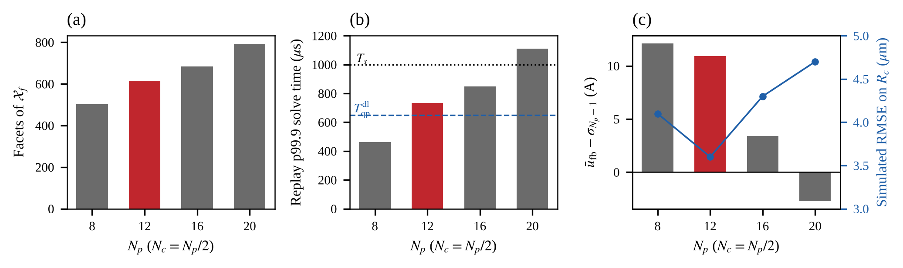
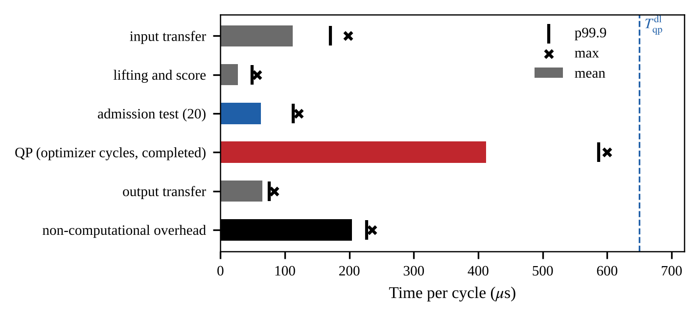

# S-VI. Computation, Timing, and Deployment

## Replay protocol

**Problem.** All four solvers solve the same condensed dense QP $\min\tfrac12\Delta U^\top H\Delta U+f^\top\Delta U$ subject to $G\Delta U\le h$ (or the two-sided form $l\le G\Delta U\le u$), $\Delta U\in\mathbb R^6$. $H$, $G$, $f$, and $h$ are condensed in every cycle from $A(\hat\vartheta_{i\mid k})$ and $z_k$; condensation is common to the four solvers and lies outside the timed segment. Each of the 616 terminal facets counts as one inequality row, and the 30 and 646 rows of Table S5 are counted as one-sided rows. The six slew constraints of (13e) with $i<N_c$ involve $\Delta U$ alone; qpOASES and HPIPM receive them as variable bounds, OSQP as identity rows, and PGS as ordinary rows.

**Reference solution and screening.** The active set returned by any solver defines an equality-constrained KKT system, which is solved in long-double precision; the solution is accepted as reference if the stationarity, primal-feasibility, dual-feasibility, and complementarity residuals are all at most $10^{-10}$, and otherwise the instance is solved by a commercial interior-point solver at its tightest tolerance. A solver result fails when $\lVert\Delta U-\Delta U_{\mathrm{ref}}\rVert_\infty>10^{-3}$ A; timing statistics use the passing instances, and failures are reported separately. An instance is *binding* when a multiplier of a row of $\mathcal X_f$ in the reference solution exceeds $10^{-9}$, i.e., when a terminal constraint is active.

**Environment.** The replay runs on the control computer with turbo disabled and the performance cores locked at their 2.2 GHz base frequency, deep C-states limited, and the timing thread pinned to an isolated performance core. At least $10^5$ instances logged on $R_c$ and $R_2$ under triggered operation are solved in their recorded order, so that each warm start follows the logged sequence of optimizer cycles; `clock_gettime(CLOCK_MONOTONIC)` brackets the data update and the solve only. The replay uses the iteration cap but no deadline. The code is compiled with gcc 11, -O3 -march=native.

## Table S11. Timing Details and Deployability

**(a) Replay.**

| Item | Value |
|---|---|
| Instances (PGS, with $\mathcal X_f$) / failing the 1 mA criterion | 200 000 / 69 (0.035 %) |
| p99.9 of the failing instances / p99.9 including them | 265 µs / 732.5 µs |
| Binding instances, Table II row (mean / p99 / p99.9 / max) | 432.0 / 709.3 / 742.8 / 784.6 µs |
| Binding share of the instances on $R_1$ / $R_c$ / $R_2$ | 22 % / 45 % / 61 % |
| Mean number of active terminal facets on $R_1$ / $R_2$ | 9 / 13 |
| $R_1$ instances (triggered operation): mean / p99.9 | 302 / 687.6 µs |

**(b) Bench, complete admission test (20), deadline $T^{\mathrm{dl}}_{\mathrm{qp}}=650$ µs.**

| Quantity | $R_1$ | $R_c$ | $R_2$ |
|---|:-:|:-:|:-:|
| Cycles | $10^6$ | $2\times10^5$ | $9.6\times10^5$ |
| Optimizer cycles (share) | 57 975 (5.8 %) | 13 427 (6.7 %) | 241 866 (25.2 %) |
| Discarded at the deadline (share of optimizer cycles) | 56 (0.10 %) | 2582 (19.2 %) | 41 423 (17.1 %) |
| Discarded as infeasible capped iterates | 0 | 32 (0.24 %) | 907 (0.37 %) |
| Fallback cycles (share of all cycles) | 0.0056 % | 1.31 % | 4.41 % |
| Longest fallback run $m$ / longest recovery (cycles) | 2 / 1 | 4 / 3 | 11 / 7 |
| Admission failures (share of cycles) | 0.59 % | 1.16 % | 3.44 % |
| Latency, triggered: mean / p99.9 / max (µs) | 319.8 / 855.6 / 893.4 | 376.6 / 778.4 / 805.3 | 370.4 / 895.4 / 931.6 |
| Latency, optimizer forced: mean / p99.9 / max (µs) | 619.5 / 673.8 / 692.7 | 646.8 / 755.1 / 814.2 | 636.8 / 767.4 / 809.9 |
| Mean-latency reduction | 48.4 % | 41.8 % | 41.8 % |
| RMSE, optimizer forced → triggered (µm) | 3.8 → 4.2 | 3.4 → 3.7 | 4.5 → 5.1 |
| Late commands | 0 | 0 | 0 |

Five fault classes with 20 injections each produced no late command. Iterates with constraint residuals (at most 0.6 A) occurred in 324 optimizer cycles on $R_1$ (0.56 %), 1019 on $R_2$ (0.42 %), and 19 during the fault injections; no transmitted command exceeded the amplitude or slew limits.

**(c) Stages, $R_1$, triggered with the complete test (µs; Fig. S5).**

| Stage | Mean | p99.9 | Max |
|---|:-:|:-:|:-:|
| Input transfer (sampling to input complete) | 112 | 171 | 198 |
| Lifting and score $\nu$ | 27 | 49 | 57 |
| Admission test (20) | 63 | 113 | 121 |
| QP, completed optimizer cycles | 412 | 587 | 600 |
| QP, first optimizer cycle after a policy run | 531 | — | — |
| Output transfer (to EtherCAT completion) | 65 | 76 | 83 |
| Non-computational overhead | 204 | 227 | 235 |

The input transfer accounts for more than half of the overhead and is the first candidate for reduction, for instance by aligning the shared-memory exchange between the soft PLC and the control thread with the EtherCAT frame; every microsecond saved there can be added to $T^{\mathrm{dl}}_{\mathrm{qp}}$.

**(d) Memory and extrapolation.**

| Component | Coefficients | Bytes (double) |
|---|:-:|:-:|
| $\mathcal X_f$ (616 facets × 9) | 5544 | 44 352 |
| $\Omega_b$ (340 facets × 9) | 3060 | 24 480 |
| $\Omega_2$, $\Omega_{\mathrm{in}}$ (upper bound) | 3060 | 24 480 |
| Scheduled model $G$ | 1530 | 12 240 |
| Policy networks (5 × 3649) | 18 245 | 145 960 |
| $P$, $K_b$, $\sigma_i$, $\mathcal W$, and others | about 200 | 1 600 |
| Total | 31 639 | 0.25 MB (half in single precision) |

A Cortex-A-class processor has about 1/3 to 1/8 of the single-thread throughput of the i7-14650HX; scaling the replay gives a 99.9th-percentile QP time of 2.2–5.9 ms, above the 1 ms period. On such a processor the optimizer cannot complete in every period, and an implementation relies on triggering and the fallback for the period guarantee and on pruning (Table S12) or a multi-rate optimizer for the optimizer cycles.

## Table S12. Terminal-Set Alternatives and Horizon

**(a) Certificate-preserving pruning.** In each cycle, only the terminal facets whose slack at the terminal state of the held sequence is below $\tau=2.2\times10^{-4}$ are loaded into the QP; all 616 facets are checked at the solution ($616\times8$ multiply–accumulate operations), and the QP is solved again with the violated facets added if needed. The transmitted solution satisfies the complete (13f), so that the certificate is unchanged.

| Item | Value |
|---|---|
| Replay with pruning: mean / p99.9 | 286 / 608 µs (full $\mathcal X_f$: 331.0 / 732.5 µs) |
| Re-solve rate | 12.2 % |
| End-to-end latency on $R_1$, pruning only (optimizer every cycle): mean / p99.9 | 362.7 / 663.1 µs |
| Triggering only (bench, Table S11): mean / p99.9 | 319.8 / 855.6 µs |
| Pruning and triggering: mean / p99.9 | 331.8 / 638.5 µs |

The rows with pruning combine the replayed solve times with the bench timing of the remaining stages, whereas the row with triggering alone is a direct bench measurement; the two kinds of figures are therefore not comparable to within a few percent. Pruning mainly shortens the tail of the solve time, triggering mainly lowers the mean, and the combination gives the lowest 99.9th percentile.

**(b) Horizon.** For $N_p\in\{8,12,16,20\}$ and $N_c=N_p/2$, the tightening, $\mathcal X_f$, and the QP were recomputed, the solve times replayed on the logged states, and the tracking error on $R_c$ simulated with the model of Table S2.

| $N_p$ | $\bar u_{\mathrm{fb}}-\sigma_{N_p-1}$ (A) | Facets of $\mathcal X_f$ | Replay p99.9 (µs) | Simulated RMSE on $R_c$ (µm) |
|:-:|:-:|:-:|:-:|:-:|
| 8 | 12.1 | 502 | 463.5 | 4.1 |
| **12** | **10.93** | **616** | **732.5** | **3.6** |
| 16 | 3.4 | 683 | 849.6 | 4.3 |
| 20 | −2.7 | 792 | 1109.4 | 4.7 |

$N_p=20$ leaves a negative margin and is infeasible; $N_p=16$ reduces the margin to 3.4 A and raises the 99.9th-percentile solve time to 85 % of the period; among the feasible horizons, $N_p=12$ gives the lowest simulated error.

**Fig. S4.** Horizon sensitivity. (a) Facets of $\mathcal X_f$; (b) 99.9th-percentile replay solve time with the deadline $T^{\mathrm{dl}}_{\mathrm{qp}}$ (dashed) and the period $T_s$ (dotted); (c) amplitude margin (bars) and simulated RMSE on $R_c$ (line). The deployed horizon is highlighted.

**Fig. S5.** Latency stages on $R_1$ under triggered operation with the complete admission test: mean (bars), 99.9th percentile, and maximum per cycle. The QP row refers to completed optimizer cycles; results later than $T^{\mathrm{dl}}_{\mathrm{qp}}$ are discarded.

Source: `cakmpc_supp/timing.py`, `tables/tableS11_*.csv`, `tables/tableS12_*.csv`, `tables/tableII_source.csv`.
